# TokenCats

코딩 에이전트에게 쓴 토큰이 츄르가 되고, 츄르로 고양이를 입양해 맥북 노치 위 작은 방에서 키웁니다.
방과 1년 사용 잔디는 GitHub 프로필 카드로 내보낼 수 있습니다.



## 무엇을 하나

- Claude Code · Codex의 사용 로그에서 토큰을 집계해 **츄르**로 바꿉니다. 훅을 연결하면 응답을 기다리는 세션도 닫힌 노치에 표시됩니다.
- 츄르로 **입양 상자**를 열어 고양이를 들이고, 방 **배경**과 **소품**을 삽니다.
- 노치를 닫으면 방 고양이들이 노치 양옆에 앉아 있고, 열면 방·장부·사용 한도·통계가 보입니다.
- 방과 1년 잔디를 **GitHub 프로필 README**의 SVG 카드로 자동 갱신합니다.

## 요구 사항

macOS 14 이상, Apple Silicon과 Intel 모두. 노치가 없는 Mac에서는 메뉴 막대 높이의 창으로 동작합니다.

## 설치

```bash
brew install --cask changchangwoo/tap/tokencats
```

- 전체 이름(`changchangwoo/tap/tokencats`)으로 설치해야 합니다. Homebrew 7은 처음 보는 tap의 짧은 이름을 거부합니다.
- TokenCats는 Apple 공증을 받지 않은 무료 배포라, 이 cask는 설치할 때 앱의 격리 표시(quarantine)를 지웁니다.
  그래서 처음 열 때 막히지 않습니다. 지우는 것은 TokenCats.app 하나뿐입니다.
- [Releases](https://github.com/changchangwoo/tokenCats/releases)에서 zip을 직접 받으면 처음 열 때 macOS가 막습니다.
  시스템 설정 › 개인정보 보호 및 보안에서 **그래도 열기**를 누르면 열립니다.
- 지우기: `brew uninstall --cask --zap tokencats` (에이전트 훅은 먼저 설정 › 에이전트에서 연결을 해제하세요)

## 빌드와 실행

```bash
scripts/build-app.sh        # Release 빌드(Apple Silicon·Intel 범용) → build/DerivedData/Build/Products/Release/
scripts/run-app.sh          # 실행 중인 앱을 내리고 새 빌드를 띄움
scripts/package-release.sh  # 릴리스 zip과 Homebrew cask를 build/release/에 만듦(올리지는 않음)
swift test                  # 코어 테스트 (SwiftPM, Swift Testing)
```

## 에이전트 연결

설정 › **에이전트**에서 Claude Code / Codex 훅을 설치합니다. 훅은 세션 알림에만 쓰이고, 토큰과 츄르는 훅 없이도 집계됩니다.
Claude Code의 공식 사용 한도를 보려면 같은 화면에서 **상태줄**을 연결합니다(Claude Code만).

## 설정

TokenCats: 일반 · 홈 표시 · 닫힌 노치 · 최적화 · 에이전트 · GitHub 프로필 · 데이터
고급: 노치(창·높이·제스처·단축키) · 정보 (Debug 빌드에는 개발자 탭이 더 있습니다)

데이터는 `~/Library/Application Support/TokenCats/`에 JSON으로 저장되고, 설정 › 데이터에서 백업·복원·초기화할 수 있습니다.

## 구조와 기여

구조는 [ARCHITECTURE.md](ARCHITECTURE.md), 작업 규칙은 [CONTRIBUTING.md](CONTRIBUTING.md)에 있습니다.
고양이·방 그림을 고치려면 [art-src/README.md](art-src/README.md)를 보세요.
고양이·방 테마·에이전트를 더하는 방법도 거기에 적혀 있습니다.

## 출처

노치 창과 열고 닫는 애니메이션은 [boring.notch](https://github.com/TheBoredTeam/boring.notch) (GPL-3.0)에서 가져와
`app/TokenCats/NotchShell/`에 두었습니다. 전체 목록은 [NOTICE.md](NOTICE.md)에 있습니다. TokenCats도 GPL-3.0입니다.
