<p align="center">
  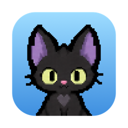
</p>

<h1 align="center">TokenCats</h1>

<p align="center">
  <a href="https://github.com/changchangwoo/TokenCats/actions/workflows/ci.yml"></a>
  
  
  
  
  
</p>

<p align="center">
  <b>English</b> · <a href="README.ko.md">한국어</a>
</p>

<p align="center">
  <b>Raise cats with your AI agent tokens, and show them off on your GitHub profile.</b><br>
  Tokens you spend in Claude Code and Codex become churu, and the cats you adopt with churu live in a room inside your MacBook notch.
</p>

<p align="center">
  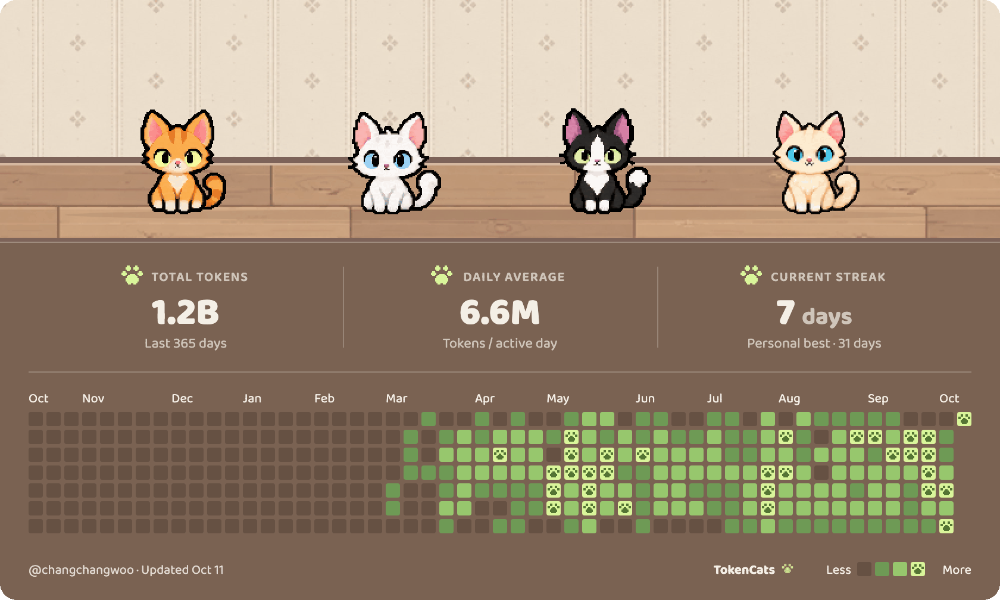
</p>

<p align="center">
  Once a day, and whenever your room changes, the app redraws a GitHub profile card that tracks your tokens.
</p>

<hr>

> TokenCats currently reads tokens from **Claude Code** and **Codex**.<br>
> Going forward, we plan to support more agents such as Gemini CLI and Kiro. Contributors are always welcome!

<p align="center">
  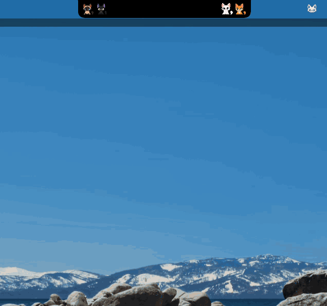
</p>

- With the notch closed, the cats sit on either side of it.
- Hover the notch and the room opens. Inside, the cats walk around, groom themselves, and float a heart when you pet them.
- Pet a cat, or right-click it to give churu, and its bond level climbs toward 99. Hover a cat to see the level, and switch on "Cat bond levels" in Settings › GitHub profile to show it on your card.
- Give a cat its own name by right-clicking it in the collection. Up to 16 characters, and a blank name brings back the coat name.
- Below the room you can see your churu, today's tokens, and your Claude and Codex usage limits.
- Home shows Claude Code's service status below its usage limits. If a Claude request fails, TokenCats checks the public status page, marks the row red, and explains any reported issue in a banner.
- The Codex tab shows OpenAI's published Codex Desktop status in the same row. OpenAI does not publish a separate Codex CLI component, and Codex does not currently send TokenCats a reliable API-failure hook.
- When Claude Code's `/usage` command reports a separate Fable weekly limit, Home shows it beside the 5-hour and weekly limits.

### How it works

<table>
<tr>
<td width="50%">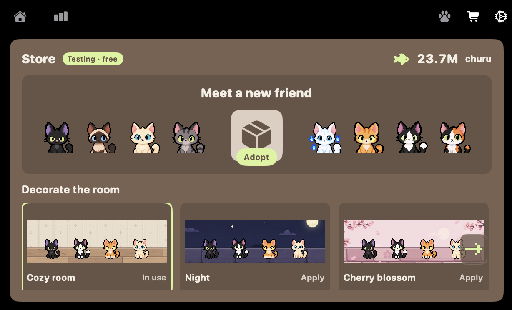</td>
<td>

1. 🪙 **Code.** TokenCats counts the tokens you spend in Claude Code and Codex.
2. 🐟 **Churu piles up.** One token is one churu, and three small daily missions add a bonus.
3. 📦 **Adopt.** An adoption box costs 10 million churu.
4. 🏠 **Decorate.** Buy backgrounds and props for the room.
5. 🖼️ **Show off.** Your room becomes your GitHub profile card.

</td>
</tr>
</table>

<details>
<summary>How exactly is churu counted?</summary>

- Three kinds of tokens count as churu: uncached input, cache writes, and output.
- Tokens read back from the cache don't count. Counting every re-read of the same content would inflate the number far too much.
- Each past day's total is frozen once the day ends, so churu you've already earned never shrinks even if log files are deleted.
</details>

### Your usage at a glance

<table>
<tr>
<td width="50%">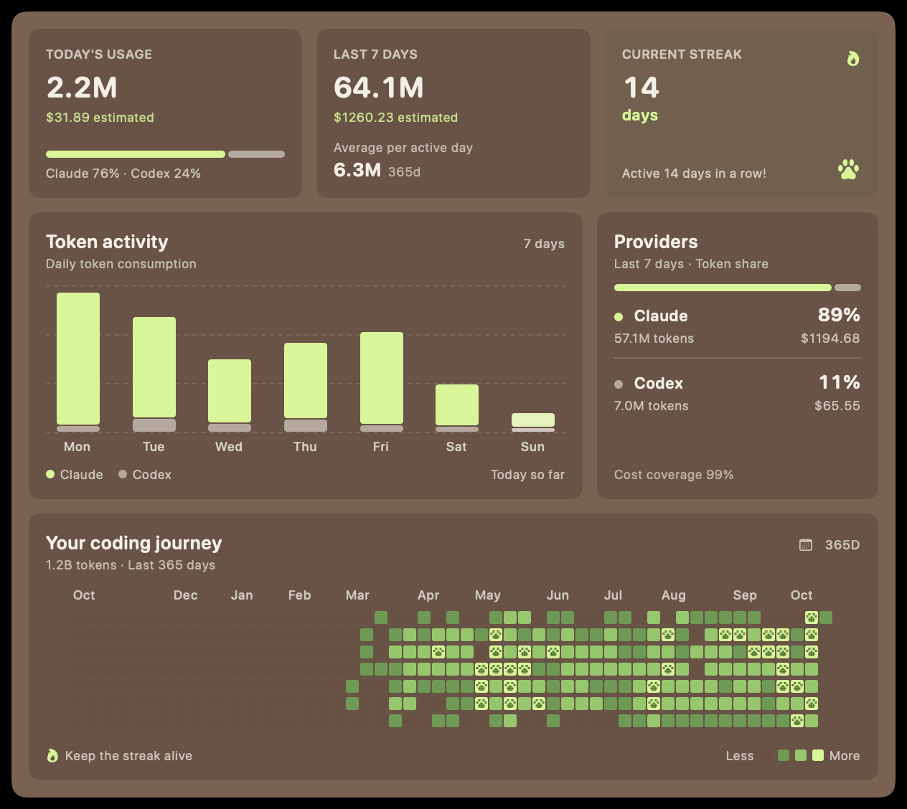</td>
<td>

- **A year of squares:** each day's tokens are painted like a GitHub contribution graph. Heavy days get a paw stamp.
- **365-day total, daily average, and usage streak** at a glance.
- **Last 7 days:** tokens per weekday, the Claude/Codex split, and estimated cost at API prices.

</td>
</tr>
</table>

### Make the room yours

<table>
<tr>
<td width="50%">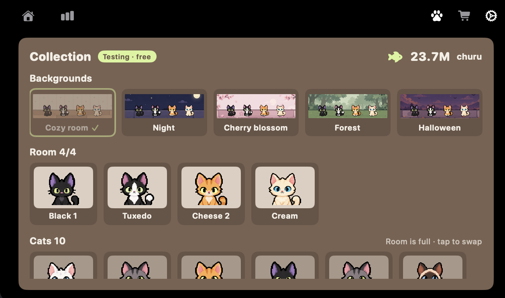</td>
<td>

Choose from five backgrounds and props, and pick what goes on your card (token counts, the year of squares).
- Tap a background in the collection and the room changes right away.
- Four cats live in the room; the rest wait in the collection.

</td>
</tr>
</table>

### Put your cats on your GitHub profile

<table>
<tr>
<td width="50%">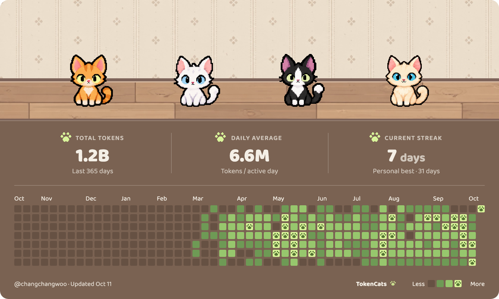</td>
<td>

Your cat room goes at the very top of your GitHub profile README as a card.

1. In the first-run setup, click **Connect with GitHub**.
2. Click **Add to README**. That's it.

- There's no server. The card is a single SVG on the `catroom` branch of your profile repository, and only the marked section of your README is touched.

</td>
</tr>
</table>

<details>
<summary>New to profile repositories?</summary>

Create a public repository on GitHub named after your username (for example `changchangwoo/changchangwoo`), and its README shows up at the top of your profile. If you don't have one yet, the app gives you a link that creates it.
</details>

<details>
<summary>Want to add it by hand?</summary>

The app inserts the block below into your README. You can paste the same thing yourself (replace `username`).

```md
<!-- tokencats:start -->
<a href="https://github.com/changchangwoo/TokenCats"></a>
<!-- tokencats:end -->
```
</details>

### Cute cats waiting for you!

Open an adoption box and a cat comes out, depending on its rarity.
Who will you meet? Isn't that exciting?

| Rarity | Odds | Cats |
|---|---|---|
| Common | 50% | 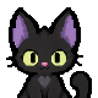 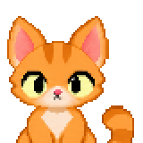 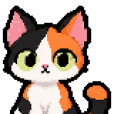 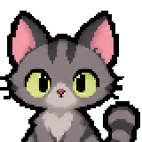 |
| Uncommon | 30% | 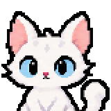 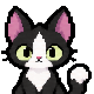 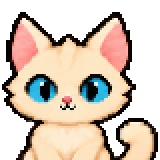 |
| Rare | 15% | 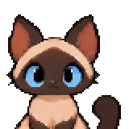 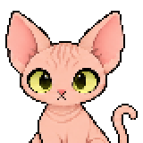 |
| Unique | 5% |  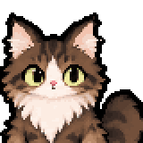 |

### Install

```sh
brew install --cask changchangwoo/tap/tokencats
```

- Runs on macOS 14 or later. On a Mac without a notch, it sits at menu bar height.
- Type the full name as shown above. Homebrew refuses to install the short `tokencats` on its own.
- To update, run `brew upgrade --cask tokencats`.
- The app is ad-hoc signed and not notarized. During installation, the Homebrew cask removes macOS quarantine from `TokenCats.app` so it can open.
- If you download the zip from [Releases](https://github.com/changchangwoo/TokenCats/releases) instead, macOS will say the app cannot be opened the first time. Open System Settings › Privacy & Security, scroll down and click **Open Anyway**, or run `xattr -dr com.apple.quarantine /Applications/TokenCats.app` in Terminal.
- After that, the app updates itself: once a day it looks for a new version and asks before installing (Settings › About).

<details>
<summary><b>Privacy</b> — what it reads, writes, and sends</summary>
<br>

| | |
|---|---|
| **Reads** | Usage logs under `~/.claude` and `~/.codex`. Only token counts and model names are counted. Prompt contents are never stored or sent |
| **Writes** | Only when enabled: one hook line in the Claude Code and Codex settings files, and one status line entry for Claude Code. The original settings are backed up, and turning it off restores them |
| **Sends** | While Home is open, the app requests public status summaries from `status.claude.com` and `status.openai.com`; it also rechecks Claude status after a Claude Code API failure. These requests contain no session details or prompts. To show Fable's weekly limit, it runs the installed Claude Code `/usage` command at most once every 15 minutes while Home is open; Claude Code may contact Anthropic for that account's usage. TokenCats keeps only the Fable percentage, not the full report. If you connect with the GitHub App, device authorization uses `github.com`. When you turn on the GitHub card, the app uploads the card SVG through `api.github.com` and reads and saves your profile README there, changing only the marked section. Once a day the app reads `raw.githubusercontent.com` to see if a newer version exists, and asks before installing one (Settings › About to turn off). Agent usage logs and prompts stay on your Mac |
| **Analytics** | None |
| **Accounts** | Connecting GitHub is optional. Use your gh login, or grant the TokenCats GitHub App access to your profile repository only |

- When editing settings files, existing settings and hooks from other tools are left alone.
- Hooks take effect in sessions opened or reopened after connecting.
- For Codex, approve the hook once with `/hooks` inside Codex after connecting.
</details>

### Contributing

- The structure is in [ARCHITECTURE.md](ARCHITECTURE.md).
- Working rules are in [CONTRIBUTING.md](CONTRIBUTING.md).
- To add cats or room art, see [art-src/README.md](art-src/README.md).

This project is open source and always open.<br>
New cats, new rooms, new items, and anything else new — we're always looking for contributors to build it with us!

### Thanks to

- TokenCats started from [boring.notch](https://github.com/TheBoredTeam/boring.notch) (GPL-3.0).<br>
  The notch window and its open/close motion come from there; the full list is in [NOTICE.md](NOTICE.md).
- The card font is [Baloo 2](https://fonts.google.com/specimen/Baloo+2).

### License

GPL-3.0

<p align="center">
  
</p>

<p align="center">
  If you like the cats, please ⭐ star the repo. It really helps development! 🐟
</p>
